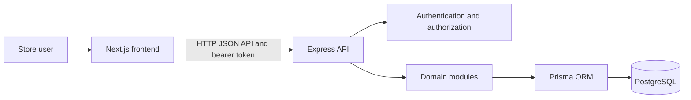

# Clothify

Clothify is a store-management platform for clothing retailers. It combines a
Next.js web application with an Express API and a PostgreSQL database to manage
products, branches, inventory, customers, sales, and returns.

## Features

- **Store administration:** dashboard, branches, users, roles, and customers.
- **Catalog management:** categories, products, and size/color variants.
- **Inventory:** branch-level stock, quantity adjustments, and reorder levels.
- **Point of sale:** search in-stock variants, build a cart, apply discounts,
  select a customer and payment method, and complete a sale.
- **Sales and invoices:** review completed sales and view or print invoices.
- **Returns and exchanges:** process returns and exchanges against existing
  sales.
- **Inventory insights:** review restock recommendations and variant demand by
  size and color.

## Application routes

| Route | Purpose |
| --- | --- |
| `/login` | Sign in |
| `/dashboard` | Store activity and inventory summary |
| `/pos` | POS checkout |
| `/sales` | Completed sales |
| `/invoices` | Customer invoices |
| `/returns` | Returns and exchanges |
| `/restock` | Restock recommendations |
| `/intelligence` | Size and color demand analysis |
| `/products` | Product catalog |
| `/categories` | Product categories |
| `/variants` | Product sizes, colors, and pricing |
| `/inventory` | Branch inventory |
| `/branches` | Store branches |
| `/customers` | Customer records |
| `/users` | Users and roles |

## Technology

- **Frontend:** Next.js App Router, React, TypeScript, Tailwind CSS
- **Backend:** Node.js, Express
- **Database:** PostgreSQL with Prisma ORM and migrations
- **Icons:** Lucide React

## Requirements

- Node.js 20 or newer
- npm 10 or newer
- PostgreSQL

## Local development

### 1. Install dependencies

From the repository root:

```bash
npm install --prefix backend
npm install --prefix frontend
```

### 2. Configure environment variables

Copy the example files:

```powershell
Copy-Item backend/.env.example backend/.env
Copy-Item frontend/.env.example frontend/.env.local
```

Set the following values in `backend/.env`:

| Variable | Description |
| --- | --- |
| `DATABASE_URL` | PostgreSQL connection string |
| `JWT_SECRET` | Long, randomly generated signing secret |
| `CORS_ORIGIN` | Allowed frontend origin; defaults to `http://localhost:3000` |
| `PORT` | API port; defaults to `5000` |
| `HOST` | API bind address; defaults to `0.0.0.0` |

The frontend uses `NEXT_PUBLIC_API_URL` from `frontend/.env.local`. Its example
value is `http://localhost:5000/api`.

Never commit real credentials or secret values. Keep them in the local
environment files, which are excluded from source control.

### 3. Apply database migrations

From the repository root:

```bash
cd backend
npx prisma migrate deploy
npx prisma generate
cd ..
```

The Prisma schema and migration history are in `backend/prisma/`.

### 4. Start the applications

Run these commands in separate terminals from the repository root:

```bash
npm run dev:backend
```

```bash
npm run dev:frontend
```

The web app is available at `http://localhost:3000`. The API is available at
`http://localhost:5000`; its health endpoint is `http://localhost:5000/health`.

## API overview

The API is mounted under `/api` and provides endpoints for:

- Authentication: `/api/auth`
- Dashboard: `/api/dashboard`
- Customers and users: `/api/customers`, `/api/users`
- Branches, categories, products, variants, and inventory:
  `/api/branches`, `/api/categories`, `/api/products`, `/api/variants`,
  `/api/inventory`
- POS and sales: `/api/pos`, `/api/sales`
- Invoices and returns: `/api/invoices`, `/api/returns`
- Restock and variant-demand analytics: `/api/analytics`

Login is available at `POST /api/auth/login`. Management APIs require
authentication. Cashier access is scoped to the cashier's assigned branch.

Sales, inventory movements, returns, and replacement sales use database
transactions to keep stock and transaction records consistent.

## Architecture

Clothify is maintained as one application with a separate frontend and API.
The Next.js App Router provides the screens, feature modules handle their
domain-specific UI and state, and the shared API client sends requests to the
Express service. The API organizes business logic by domain and accesses
PostgreSQL through Prisma.



The main responsibilities are:

- **Frontend (`frontend/app/`):** route entry points and page composition.
- **Frontend features (`frontend/features/`):** domain screens, forms, and
  user interactions.
- **Frontend API client (`frontend/lib/api.ts`):** shared requests to the
  backend.
- **Backend (`backend/src/app.js`):** Express configuration, middleware, and
  API route registration.
- **Backend domain modules (`backend/src/modules/`):** route handlers and
  business logic for authentication, catalog, inventory, sales, and analytics.
- **Database (`backend/prisma/`):** Prisma schema and versioned migrations.

Requests to protected management APIs are authenticated with a bearer token.
Role-based authorization and branch scoping are applied where required.
Database transactions protect workflows that update both sales records and
inventory.

## Verification

Run the backend syntax check and frontend production build from the repository
root:

```bash
npm run check:backend
npm run build:frontend
```

Additional frontend checks:

```bash
cd frontend
npm run lint
npm run typecheck
```

## Project structure

```text
clothify-projects/
├── README.md
├── backend/
│   ├── prisma/
│   │   ├── schema.prisma   # Data models and relations
│   │   └── migrations/     # Versioned database changes
│   └── src/
│       ├── app.js          # Express app and API route registration
│       ├── middleware/     # Authentication and error handling
│       ├── modules/        # Domain routes, controllers, and services
│       └── routes/         # Shared routes, including health
├── docs/
│   ├── architecture.md     # System design notes
│   └── development.md      # Local development and contribution guide
└── frontend/
    ├── app/                # Next.js App Router pages
    ├── features/           # Module UI and state
    ├── lib/                # Shared API client and utilities
    └── styles/             # Global application styles
```

See [`docs/architecture.md`](docs/architecture.md) for system design and
[`docs/development.md`](docs/development.md) for contribution guidance.

For production deployment on Vercel, see [DEPLOYMENT.md](DEPLOYMENT.md).
